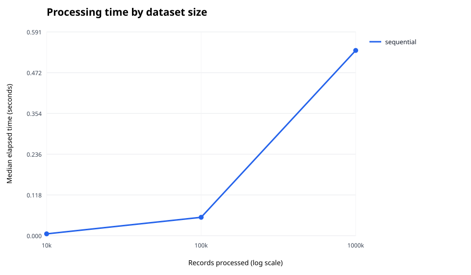

# Parallel Telemetry Engine

A High-Performance Computing (HPC) project exploring parallel data processing, workload distribution, and performance optimization through large-scale telemetry workloads.

## Overview

The Parallel Telemetry Engine is a Python-based project designed to process large volumes of synthetic system telemetry data and investigate how parallel computing techniques can improve processing performance.

The project starts with a sequential processing pipeline and progressively introduces multiprocessing and distributed execution using MPI. Performance is evaluated across different dataset sizes and worker counts to understand speedup, scalability, and computational bottlenecks.

## Objectives

- Build a telemetry processing pipeline with validation, transformation, aggregation, and anomaly detection.
- Generate synthetic telemetry datasets at configurable scales.
- Establish a sequential performance baseline.
- Implement parallel processing using Python multiprocessing.
- Explore distributed processing with MPI.
- Benchmark execution time, throughput, speedup, and parallel efficiency.
- Investigate performance bottlenecks, including I/O, memory usage, and workload imbalance.

## Planned Tech Stack

- **Language:** Python
- **Data Processing:** Pandas, PyArrow
- **Storage:** Apache Parquet
- **Parallel Computing:** Python multiprocessing, mpi4py
- **Benchmarking:** Python, Matplotlib
- **Testing:** pytest

## Development Roadmap

- [x] Build a synthetic telemetry data generator and measure its throughput across dataset sizes.
- [x] Implement the sequential processing pipeline.
- [x] Establish the sequential processing baseline across dataset sizes.
- [ ] Implement multiprocessing-based parallel processing.
- [ ] Compare static and dynamic workload distribution.
- [ ] Introduce MPI for distributed execution.
- [ ] Measure speedup, parallel efficiency, and scalability.
- [ ] Profile and optimize I/O, memory usage, and processing performance.
- [ ] Build a simple, telemetry-aware local tool as a reusable Python library and CLI. It should detect supported telemetry formats, apply built-in processing profiles, and choose worker counts automatically.

## Performance Evaluation

The engine will be evaluated using:

- Execution time
- Processing throughput
- CPU and memory utilization
- Parallel speedup
- Parallel efficiency
- Strong and weak scaling

Benchmark results will be documented as implementations and experiments are completed.

## Project Status

**In development.** The project has a deterministic telemetry generator, a sequential validation and aggregation pipeline, and initial generation and processing baselines. Multiprocessing comparison is next.

## Getting Started

The project currently uses only the Python standard library. From the repository root, install it in editable mode:

```bash
python3 -m pip install -e .
```

Generate records from Python and optionally write them as JSON Lines:

```python
from telemetry_engine import iter_records
from telemetry_engine.generate import write_jsonl

with open("telemetry.jsonl", "w", encoding="utf-8") as output:
    count = write_jsonl(iter_records(100_000, seed=42), output)
print(f"Wrote {count} records")
```

`iter_records` yields one record at a time, so creating a large workload does not require keeping the whole dataset in memory. Use `invalid_rate=0` for all-valid data or `invalid_rate=1` for all-invalid data. The default is 1% invalid records. A fixed seed produces the same records on repeated runs.

## Sequential Pipeline

`process_records(records)` consumes an iterable once. It counts and skips invalid records, then reports count, minimum, maximum, and average for each metric. It also counts threshold anomalies among valid records: CPU and memory above 90%, temperature above 80 C, and disk read speed above 450 MB/s. These simple thresholds are project defaults for learning and can be adjusted in `src/telemetry_engine/pipeline.py`.

## Benchmarks

Run the generation baseline after installing the package:

```bash
python3 benchmarks/benchmark_generation.py --sizes 10000 100000 1000000 --repeats 3
```

The CSV output reports median elapsed time and records per second for each dataset size. To include JSONL serialization cost without measuring filesystem speed, use `--workload jsonl`. Set `--seed` to keep the generated workload reproducible. The benchmark consumes records without saving a data file.

### Initial generation baseline

Measured with Python 3.13.0 on macOS 14.6.1 (Apple Silicon), using seed 42, three measured trials, and the median time. This measures generation only; it does not include processing or disk I/O.

| Records | Median time | Throughput |
| ---: | ---: | ---: |
| 10,000 | 0.014964 s | 668,284 records/s |
| 100,000 | 0.147556 s | 677,707 records/s |
| 1,000,000 | 1.468282 s | 681,068 records/s |

These results are a local reference point, not a comparison against another implementation. Re-run the command on the same machine when measuring changes.

### Sequential processing baseline

Run the sequential pipeline against the same seeded record sizes. The benchmark creates each dataset before starting the timer, so these timings cover validation, aggregation, and anomaly detection, but exclude data generation and file I/O:

```bash
python3 benchmarks/benchmark_sequential.py --sizes 10000 100000 1000000 --repeats 3 --seed 42 --output benchmarks/results/sequential_baseline.csv
python3 benchmarks/plot_results.py benchmarks/results/sequential_baseline.csv --output benchmarks/results/sequential_processing_time.svg
```

The raw CSV includes valid, invalid, and anomalous record counts, timing, throughput, and environment details. This local run used Python 3.13.0 on macOS 14.6.1 (Apple Silicon), with seed 42 and three measured trials:

| Records | Valid | Invalid | Anomalies | Median time | Throughput |
| ---: | ---: | ---: | ---: | ---: | ---: |
| 10,000 | 9,891 | 109 | 1,186 | 0.005364 s | 1,864,237 records/s |
| 100,000 | 98,977 | 1,023 | 12,359 | 0.053384 s | 1,873,213 records/s |
| 1,000,000 | 989,792 | 10,208 | 123,753 | 0.536847 s | 1,862,727 records/s |



To compare a future implementation, pass its result CSV alongside this one to `plot_results.py`. The chart groups rows by the `mode` column, so use a distinct mode such as `multiprocessing` in future benchmark results. It plots median elapsed time against record count on a logarithmic x-axis. These measurements are hardware- and runtime-specific reference points.

Install the development extra to run the unit tests with pytest:

```bash
python3 -m pip install -e ".[dev]"
python3 -m pytest
```

## Learning Goals

This project aims to develop practical knowledge of HPC fundamentals, parallel programming, distributed execution, performance profiling, and scalability analysis.
